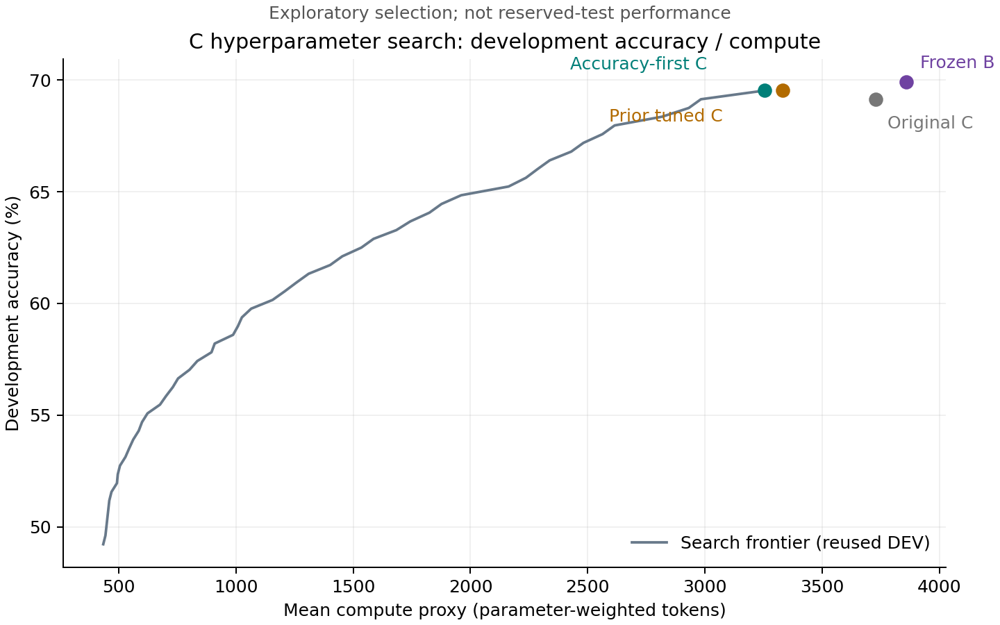
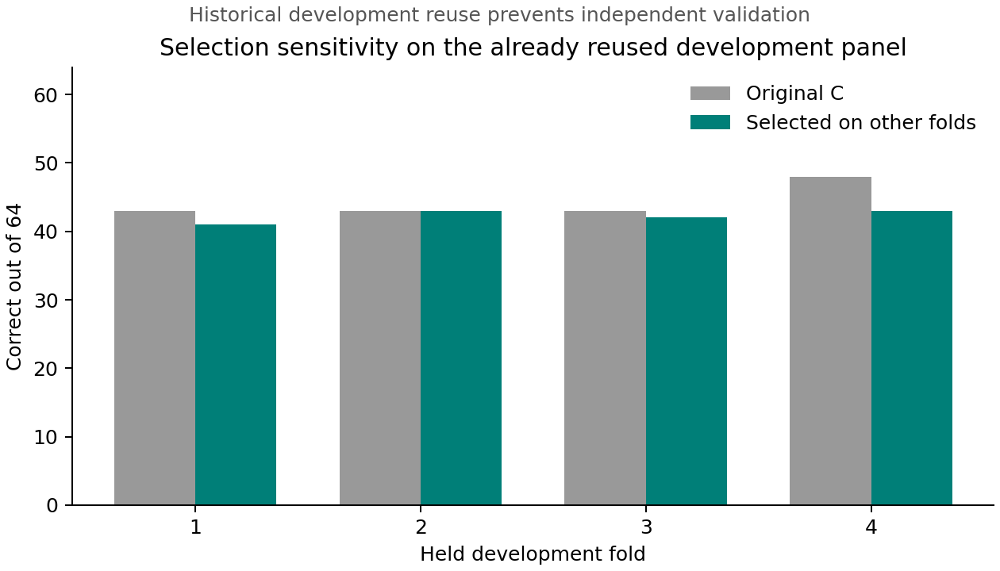

# Accuracy-first C tuning — 2026-11-27

## Finding and decision

**This refinement did not improve accuracy beyond the preceding 178/256 candidate.** Its benefit is a further 2.249930% reduction in the compute proxy.

The bounded accuracy-first refinement selects **178/256 (69.531250%)** at mean compute **3255.708230152**. That is +1 correct versus frozen C, +0 versus the prior 178/256 tuned candidate, and -1 versus frozen B. These are results on the repeatedly reused development panel, not reserved-test results.

| Policy | Correct / 256 | Accuracy | Mean compute proxy |
| --- | ---: | ---: | ---: |
| Frozen A | 153 | 59.765625% | 1087.274836 |
| Frozen B | 179 | 69.921875% | 3858.277710 |
| Frozen C | 177 | 69.140625% | 3728.575440 |
| Earlier cost-constrained C | 178 | 69.531250% | 3330.645425 |
| Accuracy-first C | 178 | 69.531250% | 3255.708230 |

Compute reduction relative to frozen C is 12.682249%; relative to B it is 15.617577%. Negative reduction would mean an increase. The four-fold selection-sensitivity diagnostic yields **169/256 versus original C's 177/256**, so the full-panel selection must not be treated as independent confirmation. Keep both frozen and experimental checkpoints. No claim of statistical significance or generalization is made.



## What changed

Only existing scalar hyperparameters changed. The exact selected settings are in [summary.json](summary.json):

| Existing subject expert | Penalty | Review threshold | Physics first-parent prior |
| --- | ---: | ---: | --- |
| math | 0.005 | 0.0012907894111215119 | unchanged |
| chemistry | 0.0005 | 0 | unchanged |
| physics | 0.0175 | 0.034663890700664418 | 0.05 |

Physics uses the same ordered two parents with weights `w` and `1-w`. Math retains `smooth32-review1`; chemistry retains `smooth8-review1`. No model classes, trained weights, tokenizer, features, dynamics, signal adapter, routing structure, solver/reviewer budgets, cache rules or billing formulas changed. The audit reverses only these settings/weights and recovers exactly the original model serialization. The pickle retains original ancestry/fit receipts; the new `summary.json`, registration and audit describe the selected settings and newly measured scores, not inherited expert score metadata.

## Search definition and accounting

See the [predeclared protocol](../../../experiments/c-hyperparameter-tuning/ACCURACY_PROTOCOL.md), [source](../../../experiments/c-hyperparameter-tuning/accuracy_first.py) and [registration](registration.json). The protocol was committed before results were available. This is a sequential refinement informed by the earlier search, not an independent preregistered hypothesis test.

The fixed grid contains 32 compute penalties and 25 positive physics prior weights. Math and chemistry have 32 penalty settings each; physics has 800 penalty/prior settings. Each of these 864 pairs gets the preceding fixed threshold grid plus representatives of every nonnegative gate interval identified from its predicted information values. Threshold generation does not consult correctness labels. Model selection does use development correctness. The original configuration for each subject is retained.

| Subject | Questions | Candidate settings including original | Maximum correct in search |
| --- | ---: | ---: | ---: |
| math | 128 | 2,399 | 124 |
| chemistry | 64 | 2,196 | 28 |
| physics | 64 | 56,503 | 26 |

Total subject candidates: **61,098**. This is not a count of independent full-panel experiments. Combining subject candidates increases selection flexibility and overfitting risk.

The primary objective is highest total correctness without a compute ceiling, then lowest compute. Dynamic programming stores the cheapest solution for each integer correct count; a separate enumeration of subject correctness/cost frontiers checks the selected objective. Postprocessing independently recomposes the full frontier from saved candidate metrics.

The original runtime's threshold-zero and no-review outcomes provide the two branches for each penalty/prior. Its exact comparison `information_value > threshold + 1e-9` selects the branch for each threshold. This does not grant access to unpaid observations at inference: the selected model is subsequently replayed through the unchanged router with only its actually paid prefix and with labels erased.

Secondary constrained optima:

| Constraint | Correct | Mean compute proxy |
| --- | ---: | ---: |
| Original C mean-compute ceiling | 178/256 | 3255.708230 |
| Strictly below B mean compute | 178/256 | 3255.708230 |

These outcomes and all selected parameters are retained even if they match the primary optimum. A, B and the five fixed baselines are unchanged reference results from the earlier verified release replay; this experiment only tunes C.

## Selection sensitivity, including negative evidence

Four folds are stratified by subject using RNG seed `20261127`. For each fold, select parameters on the other three folds using accuracy-first selection without a compute ceiling; then score the held fold. No threshold or model is adapted to its held-fold correctness. Threshold candidate intervals were generated from the complete development panel's label-free information values, which makes this diagnostic transductive as well as historically reused.

| Held development fold | Selected correct / 64 | Original C correct / 64 | Selected mean compute |
| --- | ---: | ---: | ---: |
| 1 | 41 | 43 | 2857.6374 |
| 2 | 43 | 43 | 3289.3469 |
| 3 | 42 | 43 | 3194.4183 |
| 4 | 43 | 48 | 2965.3920 |
| Total / mean | 169/256 | 177/256 | 3076.6986 |



The original checkpoint and this panel have already been selected repeatedly, including in previous experiments. The reference policy has seen the whole panel through historical model selection. Therefore this is a sensitivity diagnostic, not clean cross-validation, fresh confirmation, or a reserved-test comparison. Report it alongside the selected headline, not as an independent evaluation. A larger search can improve a reused development score without improving performance on new questions.

## Per-question changes and audit

Against original C: **1 newly correct, 0 newly incorrect**, with 67 questions changing paths or bills. [changed-questions.json](changed-questions.json) lists IDs, subjects, before/after paths, correctness and compute differences. [per-question.json](per-question.json) contains the full selected traces and accounting.

[Independent saved-model audit](audit.json) passed:

- Artifact hashes verified against the completion manifest.
- Actual saved pickle reloaded in a separate process.
- Exact original serialization recovered after reverting only settings and prior weights.
- All 256 selected outcomes reproduced directly, and all 256 label-blinded paid-observation replays matched their decisions and bills.
- Correctness regraded from the frozen solver response and labels; all solver, physical-review token and deduplicated observer component bills recomputed independently.
- Original horizon and paid observation restrictions preserved.

The search itself also performs the direct/blinded replay and independent objective checks. These are consistency and implementation checks, not evidence of new-question accuracy. Pre/post manifests verify the same 17,904 installed frozen input files, including source and checkpoint weights. The separate earlier full-archive verification covered all 38,826 files. No frozen input is intentionally edited. No new neural forwards, model fitting, cloud jobs or paid compute were used. The reserved 1,024-question test was not used for selection, inference or grading.

## Artifacts and exact reproduction

All candidate metrics and outcomes are retained. `candidate-outcomes.json.gz` is compressed JSON keyed by subject, with every candidate index and each question's ID, path, correctness and compute. This avoids storing repetitive raw traces for every grid point; full selected traces are retained separately. `candidate-metrics.json` maps the same indices to exact settings and scores. `complete.json` records the original output hashes; `audit.json`, the analysis, figures and this report are post-completion artifacts. Packaging may losslessly compress large JSON files; `packaging.json` records those mappings and original-byte hashes.

Use the frozen `abc-runtime-2026-11-25` runtime and its hash-locked Python 3.12.11 environment. Preserve strict cache fingerprint and source checks. Copy `accuracy_first.py` and `audit.py` into `runs/extensions/` in the extracted runtime; invoke both through the original adapter:

```bash
export PYTHONDONTWRITEBYTECODE=1 OMP_NUM_THREADS=1 OPENBLAS_NUM_THREADS=1 VECLIB_MAXIMUM_THREADS=1
/path/to/pinned-venv/bin/python scripts/reproduction/run.py \
  runs/extensions/accuracy_first.py /absolute/path/to/new-accuracy-output
/path/to/pinned-venv/bin/python scripts/reproduction/run.py \
  runs/extensions/audit.py /absolute/path/to/new-accuracy-output
```

The output directory must be new. Use the native macOS environment if strict numeric cache fingerprints fail on another platform; do not bypass those checks. In this session, the pinned environment lives outside the offloaded Documents folder, and Python bytecode writes are disabled. No dependency versions were changed to improve scores.

Run `analyze_accuracy.py OUTPUT` and then `document_accuracy.py OUTPUT` from the experiment source directory after the audit to regenerate analysis/figures/report. Matplotlib is needed only for plotting, not for policy replay. When auditing published compressed artifacts, restore any `packaging.json` decompressed filenames into a new copy first. See the [release setup guide](../../reproduction/README.md) for the full archive and dependencies.

## What this does not establish

The runtime review gate, compute penalty and model-prior sweep did not find an additional correct answer, even after removing the compute ceiling. Inspection of the observer code also shows that temperature affects learned calibration features and review-observation categories; a principled calibration follow-up should tune/refit those components using training-only folds and preserve their observation-model consistency. That follow-up was not performed here, and no temperature adjustment or trained-coefficient modification is hidden in this checkpoint.

This search is finite in penalty and prior weight; it enumerates the gate intervals for those grid pairs, not every possible hyperparameter or policy. It does not establish a global accuracy optimum or settle whether further training/calibration would help. It does not evaluate the reserved test, measure wall-clock inference speed, or show that the best development checkpoint generalizes. The next credible accuracy claim requires a frozen configuration and genuinely fresh evaluation, kept separate from further tuning.
