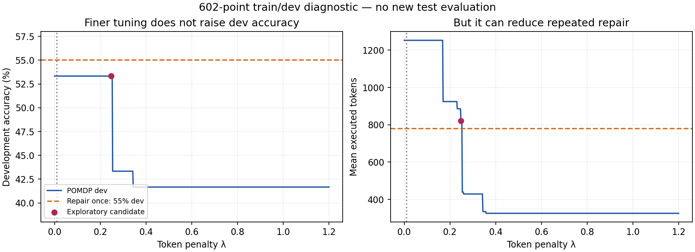
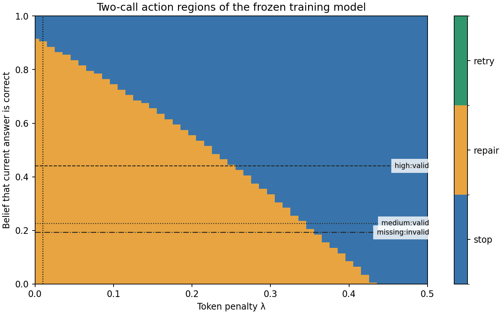

# Fine lambda diagnostic: what it changes and what it cannot fix

This follow-up examines the frozen two-state model on train/dev only. It does not replace the predeclared primary result, refit the model, or re-evaluate test. Its purpose is to understand whether the coarse original sweep hid useful adaptive behavior.

## Result

The 602-point grid covers 0 through 1.2 in steps of 0.002, plus 0.001. It produces eight distinct dev path policies. The highest observed dev accuracy remains **32/60 (53.33%)**. Among policies with that accuracy, the lowest-token grid candidate is **λ = 0.248**, using **820.55 tokens/question**, a **34.5% reduction** from the original POMDP. Its choices are 52 repair-then-stop, six repair-twice, and two immediate-stop episodes.

| Dev method | Correct | Mean tokens |
|---|---:|---:|
| Frozen POMDP, λ = 0.01 | 32/60 | 1,253.03 |
| Exploratory POMDP, λ = 0.248 | 32/60 | 820.55 |
| Fixed repair once | 33/60 | 779.22 |

**This does not improve accuracy or beat repair once on dev.** The 54.75% figure is the previously viewed test repair-twice score; comparing it with dev accuracy would mix splits. No new test performance is claimed for λ = 0.248. Searching 602 correlated settings on only 60 dev questions can overfit; the candidate is exploratory, not a confirmed generalization result.

## Policy changes found by the grid

The lambda column is the first sampled grid value exhibiting each path pattern, not an exact transition boundary.

| First grid λ | Dev accuracy | Mean tokens | Action sequence counts |
|---|---:|---:|---|
| 0.0 | 53.33% | 1253.03 | {'repair -> repair': 60} |
| 0.17 | 53.33% | 924.58 | {'repair -> stop': 42, 'repair -> repair': 18} |
| 0.232 | 53.33% | 886.12 | {'repair -> stop': 42, 'repair -> repair': 16, 'stop': 2} |
| 0.248 | 53.33% | 820.55 | {'repair -> stop': 52, 'repair -> repair': 6, 'stop': 2} |
| 0.254 | 43.33% | 439.35 | {'stop': 47, 'repair -> stop': 10, 'repair -> repair': 3} |
| 0.26 | 43.33% | 429.10 | {'stop': 47, 'repair -> stop': 11, 'repair -> repair': 2} |
| 0.344 | 41.67% | 334.63 | {'stop': 59, 'repair -> stop': 1} |
| 0.358 | 41.67% | 325.57 | {'stop': 60} |

## Check between grid points

A separate model-based piecewise-linear calculation enumerated 64 breakpoints over [0, 1.2] and checked 253 boundaries, interval midpoints, and nearby probes. It recovered the same eight dev policies and the same 53.33% best observed dev accuracy. The lower-token policy begins near λ = 0.24717 under the frozen tie handling. See [the boundary analysis](../pomdp-lambda-regions/README.md). This is a numerical check of this fixed finite-horizon model, not a proof that no redesigned controller can improve.

## What we learned about the model

Of the 100 training roots, **82 have exactly the same high-confidence/valid observation**, but only **37 of those 82 are correct**. The other observed groups are medium-confidence/valid (3/15 correct) and missing-confidence/invalid (0/3 correct). The POMDP therefore maps most starting answers to the same initial correctness belief, about 0.44, regardless of question content or domain. Smoothed probabilities for unobserved categories are prior-driven, not empirical evidence.

Changing lambda changes the cost preference and can reduce unnecessary repeat calls. It does not add information that distinguishes which individual answers need repair. The coarse sweep did hide mixed policies, but a finer sweep did not solve the accuracy limitation. The action map below shows how actions depend on belief and cost; horizontal lines mark the three observed training-root belief groups. It is a model-based diagnostic, not another baseline.

## Next justified experiment

If improving accuracy is the goal, the next candidate should change the available information or the fitted dynamics, rather than keep searching lambda. A separately documented train/dev experiment could add a history-aware answer-change observation while retaining two hidden states. Domain-specific estimates are another previously deferred option, but would split the small training set. Neither should be silently added to the milestone or tuned to individual test failures. Four states without informative observations are not guaranteed to help.

The frozen design, model, original dev/test results, and primary penalty remain unchanged. No Modal resources or paid inference were used. Raw sweep summaries, distinct per-question paths, source hashes, the selection rule, plots, and independent validation are archived here.
